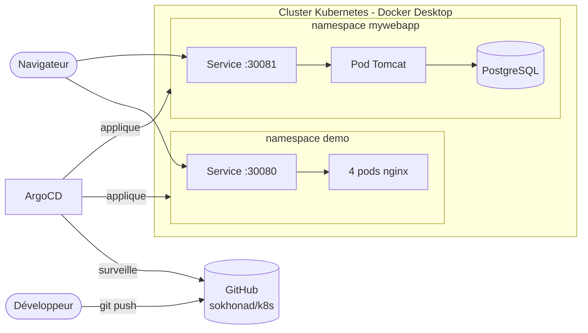
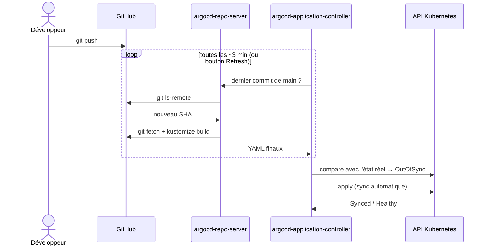
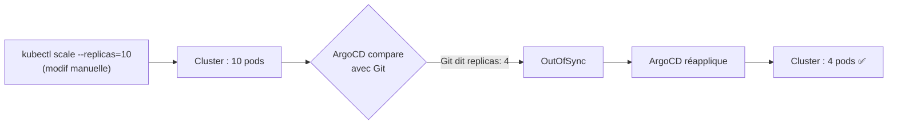
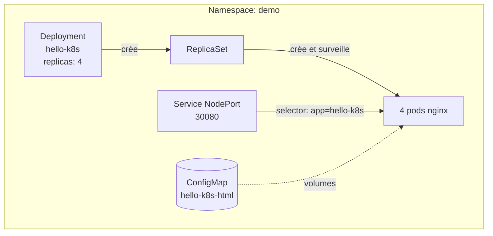
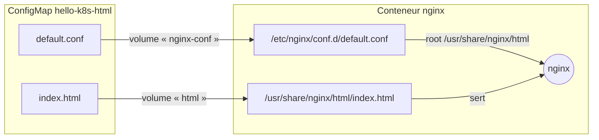
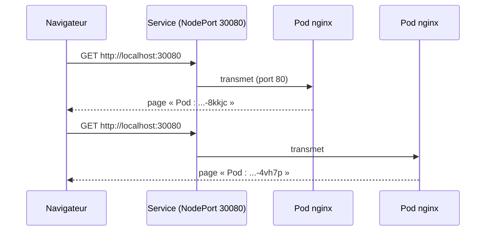
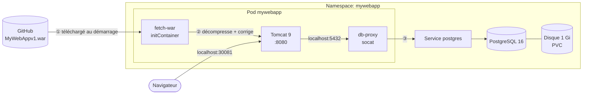
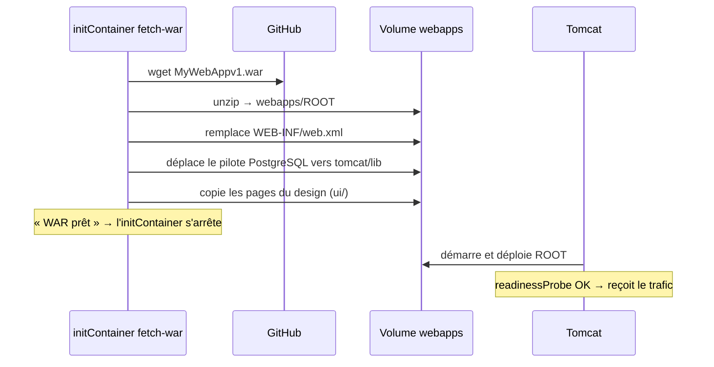
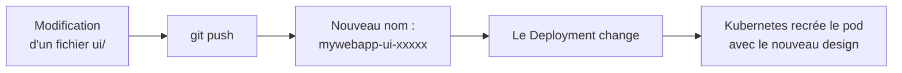
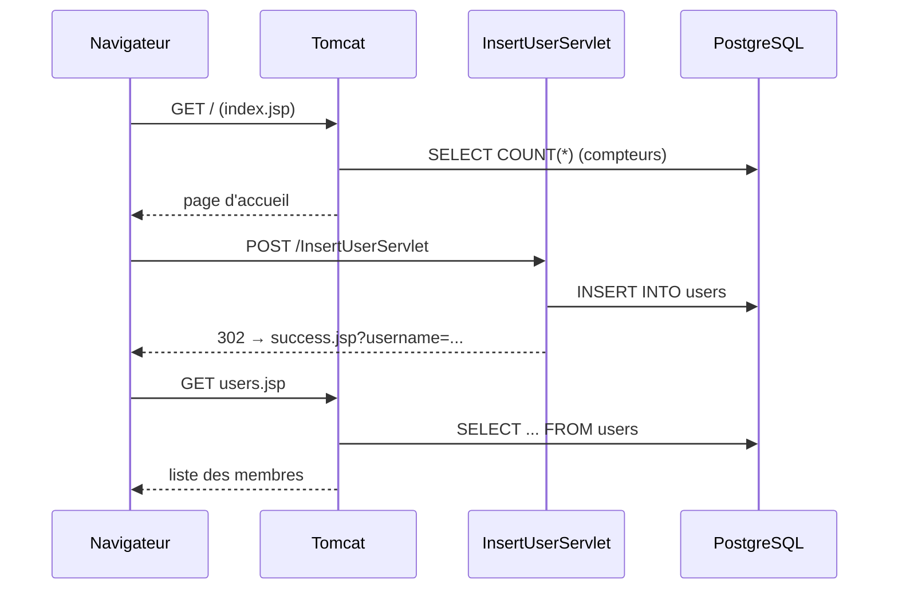

# k8s : applications Kubernetes en GitOps

Ce dépôt décrit deux applications déployées sur **Kubernetes** (Docker Desktop) et gérées en **GitOps** avec **ArgoCD** : tout changement poussé sur `main` est appliqué automatiquement dans le cluster.

| Application | Technologie | URL | Dossier |
|---|---|---|---|
| **hello-k8s** | nginx + page statique | http://localhost:30080 | [k8s/](k8s/) |
| **mywebapp** | WAR Java sur Tomcat 9 + PostgreSQL | http://localhost:30081 | [apps/mywebapp/](apps/mywebapp/) |

> 🎓 Pour apprendre à tout reconstruire pas à pas : [12 exercices guidés](exercices/README.md).

---

## Sommaire

- [Vue d'ensemble](#vue-densemble)
- [Structure du dépôt](#structure-du-dépôt)
- [Le déploiement GitOps avec ArgoCD](#le-déploiement-gitops-avec-argocd)
- [Application 1 : hello-k8s](#application-1--hello-k8s)
- [Application 2 : mywebapp](#application-2--mywebapp)
- [Prérequis](#prérequis)
- [Installation](#installation)
- [Utilisation au quotidien](#utilisation-au-quotidien)
- [Commandes utiles](#commandes-utiles)
- [Dépannage](#dépannage)

---

## Vue d'ensemble



| Élément | Rôle |
|---|---|
| **GitHub** | Source de vérité : ce qui est dans le dépôt, c'est ce qui tourne dans le cluster |
| **ArgoCD** | Compare Git au cluster et applique automatiquement les différences |
| **Cluster** | Kubernetes à un nœud fourni par Docker Desktop (kubeadm) |
| **Namespaces** | Chaque application est isolée dans son propre espace (`demo`, `mywebapp`) |

---

## Structure du dépôt

```
.
├── README.md
├── MyWebAppv1.war              # L'application Java (téléchargée par le pod au démarrage)
├── argocd/
│   ├── application.yaml        # App ArgoCD "hello-k8s"  → dossier k8s/
│   └── mywebapp.yaml           # App ArgoCD "mywebapp"   → dossier apps/mywebapp/
├── k8s/                        # Application hello-k8s
│   ├── kustomization.yaml
│   ├── namespace.yaml
│   ├── configmap.yaml          # Page HTML + config nginx
│   ├── deployment.yaml         # 4 pods nginx
│   └── service.yaml            # Port 30080
└── apps/mywebapp/              # Application mywebapp
    ├── kustomization.yaml      # Liste des fichiers + génération de la ConfigMap du design
    ├── namespace.yaml
    ├── postgres.yaml           # Base PostgreSQL + disque + table users
    ├── configmap.yaml          # web.xml corrigé
    ├── deployment.yaml         # Téléchargement du WAR + Tomcat + proxy base de données
    ├── service.yaml            # Port 30081
    └── ui/                     # Design de l'application (pages JSP + CSS)
        ├── styles.css
        ├── _common.jspf
        ├── index.jsp
        ├── users.jsp
        ├── success.jsp
        └── error.jsp
```

> Les fichiers de `argocd/` s'appliquent une seule fois, à la main. Ensuite, ArgoCD surveille seul les dossiers `k8s/` et `apps/mywebapp/`.

---

## Le déploiement GitOps avec ArgoCD

### Le principe

Personne ne lance `kubectl apply` à la main : **on modifie Git, et ArgoCD met le cluster à jour**.



### Où ArgoCD applique les YAML

Les YAML sont appliqués **depuis l'intérieur du cluster**, par deux pods du namespace `argocd` :

| Pod | Rôle |
|---|---|
| `argocd-repo-server` | Clone le dépôt et génère les YAML (`kustomize build`) |
| `argocd-application-controller` | Compare Git et le cluster, puis applique via l'API Kubernetes (`https://kubernetes.default.svc`) |

### Les options de synchronisation

Les deux applications ([argocd/application.yaml](argocd/application.yaml), [argocd/mywebapp.yaml](argocd/mywebapp.yaml)) utilisent les mêmes réglages :

| Option | Effet |
|---|---|
| `automated` | Chaque push sur `main` est déployé automatiquement |
| `selfHeal: true` | Annule les modifications faites à la main dans le cluster |
| `prune: true` | Supprime du cluster ce qui a été supprimé de Git |
| `CreateNamespace=true` | Crée le namespace s'il n'existe pas |

### Auto-réparation (selfHeal)



> Conséquence : pour changer quoi que ce soit (nombre de pods, page, image…), il faut **passer par Git**.

### Lien vers l'application dans ArgoCD

Chaque Service porte une annotation qui ajoute une icône **↗** dans l'interface ArgoCD :

```yaml
metadata:
  annotations:
    link.argocd.argoproj.io/external-link: http://localhost:30080
```

---

## Application 1 : hello-k8s

Un serveur **nginx** sert une page HTML qui affiche le **nom** et l'**IP du pod** qui a répondu, ce qui permet de voir la répartition de charge.

### Les ressources



| Fichier | Ressource | Ce qu'elle fait |
|---|---|---|
| [namespace.yaml](k8s/namespace.yaml) | `Namespace` | Isole l'app dans `demo` |
| [configmap.yaml](k8s/configmap.yaml) | `ConfigMap` | Contient `index.html` (la page) et `default.conf` (config nginx) |
| [deployment.yaml](k8s/deployment.yaml) | `Deployment` | 4 pods `nginx:1.27-alpine`, avec limites CPU/RAM et sondes de santé |
| [service.yaml](k8s/service.yaml) | `Service` | Expose les pods sur `localhost:30080` et répartit le trafic |

### Comment nginx trouve la page

La page n'est **pas** dans l'image Docker : elle vient de la ConfigMap, montée comme un dossier dans le conteneur.



```yaml
# deployment.yaml
volumes:
  - name: html
    configMap:
      name: hello-k8s-html
      items:
        - key: index.html
          path: index.html
volumeMounts:
  - name: html                         # même nom que le volume
    mountPath: /usr/share/nginx/html
```

### Afficher le nom du pod

La config nginx active les **SSI** (`ssi on;`). nginx remplace ces balises au moment de servir la page :

```html
<!--# echo var="hostname" -->     → nom du pod
<!--# echo var="server_addr" -->  → IP du pod
```

### Parcours d'une requête



---

## Application 2 : mywebapp

Application web Java ([MyWebAppv1.war](MyWebAppv1.war)) : inscription d'utilisateurs et liste des membres, stockés dans **PostgreSQL**.

### Architecture



| Conteneur | Rôle |
|---|---|
| `fetch-war` (initContainer) | Télécharge le WAR depuis GitHub, le décompresse comme application `ROOT`, applique les corrections et le design |
| `tomcat` | Exécute l'application Java |
| `db-proxy` | Redirige `localhost:5432` vers le Service `postgres` |
| `postgres` (autre pod) | Stocke les utilisateurs sur un disque persistant |

### Analyse du WAR et corrections appliquées

Le fichier WAR n'est **pas modifié** : toutes les corrections sont faites au démarrage par l'initContainer.

| Constat dans le WAR | Problème | Correction |
|---|---|---|
| Compilé en Java 8, utilise `javax.servlet` | Incompatible avec Tomcat 10+ (`jakarta`) | Image `tomcat:9.0-jdk17-temurin` |
| Connexion en dur à `localhost:5432`, utilisateur `userdb` | La base n'est pas dans le même conteneur | Sidecar `socat` dans le pod + identifiants identiques dans [postgres.yaml](apps/mywebapp/postgres.yaml) |
| `web.xml` en version 2.3 | Tomcat ignore les `@WebServlet` → servlets en **404** | `web.xml` 4.0 fourni par [configmap.yaml](apps/mywebapp/configmap.yaml) |
| Pilote PostgreSQL dans `WEB-INF/lib` | `DriverManager` ne le trouve pas (*No suitable driver*) | Déplacé dans `tomcat/lib` |
| `date_of_birth` envoyé avec `setString()` | Refusé par une colonne de type `DATE` | Colonne `VARCHAR(20)` |
| Redirection vers `error.jsp` en cas d'erreur | La page n'existe pas dans le WAR | Ajoutée dans `ui/` |
| `success.jsp` affiche le nom sans échappement | Faille **XSS** | Nom échappé dans la nouvelle page |

### Le démarrage du pod



### Le design

Les pages de l'interface sont dans [apps/mywebapp/ui/](apps/mywebapp/ui/) et sont compilées par Tomcat au premier accès.

| Fichier | Page |
|---|---|
| [index.jsp](apps/mywebapp/ui/index.jsp) | Accueil : accroche, compteurs en direct (membres, villes), formulaire d'inscription |
| [users.jsp](apps/mywebapp/ui/users.jsp) | Liste des membres avec avatars et recherche instantanée |
| [success.jsp](apps/mywebapp/ui/success.jsp) | Confirmation d'inscription |
| [error.jsp](apps/mywebapp/ui/error.jsp) | Page d'erreur |
| [_common.jspf](apps/mywebapp/ui/_common.jspf) | Code partagé : échappement HTML, connexion à la base, barre de navigation |
| [styles.css](apps/mywebapp/ui/styles.css) | Styles, avec mode sombre automatique et affichage mobile |

L'inscription passe toujours par le servlet d'origine `InsertUserServlet`.

#### Mise à jour automatique du design

[kustomization.yaml](apps/mywebapp/kustomization.yaml) génère la ConfigMap du design avec `configMapGenerator`. Son nom contient une empreinte du contenu (ex : `mywebapp-ui-k77fhthbgd`) :



### Parcours d'une inscription



### Les données

- La table `users` est créée au premier démarrage de PostgreSQL par le script de la ConfigMap `postgres-init`.
- Les données sont sur un **PersistentVolumeClaim** de 1 Gi : elles survivent au redémarrage des pods.
- Les identifiants (`userdb` / `mywebapp`) sont imposés par le WAR et stockés dans le Secret `postgres`.

> ⚠️ Le mot de passe de la base est écrit en clair dans le WAR, donc visible dans ce dépôt public. À corriger dans le code Java avant toute mise en production.

---

## Prérequis

- **Windows** avec la *Plateforme d'ordinateur virtuel* et *WSL* activées (PowerShell en administrateur, puis redémarrage) :
  ```powershell
  Enable-WindowsOptionalFeature -Online -FeatureName VirtualMachinePlatform -All -NoRestart
  Enable-WindowsOptionalFeature -Online -FeatureName Microsoft-Windows-Subsystem-Linux -All -NoRestart
  ```
- **Docker Desktop** avec Kubernetes activé : Settings → Kubernetes → *Enable Kubernetes* → méthode **Kubeadm**
- **kubectl** (fourni avec Docker Desktop)
- **git**

---

## Installation

### 1. Sélectionner le cluster

```powershell
kubectl config use-context docker-desktop
kubectl get nodes        # le nœud doit être "Ready"
```

### 2. Installer ArgoCD

```powershell
kubectl create namespace argocd
kubectl apply -n argocd --server-side -f https://raw.githubusercontent.com/argoproj/argo-cd/stable/manifests/install.yaml
kubectl -n argocd get pods -w     # attendre que tout soit Running, puis Ctrl+C
```

### 3. Ouvrir l'interface ArgoCD

```powershell
# Mot de passe de l'utilisateur "admin"
$p = kubectl -n argocd get secret argocd-initial-admin-secret -o jsonpath="{.data.password}"
[Text.Encoding]::UTF8.GetString([Convert]::FromBase64String($p))

# Accès à l'interface (laisser la fenêtre ouverte)
kubectl -n argocd port-forward svc/argocd-server 8080:443
```

Ouvrir **https://localhost:8080** (accepter l'avertissement de certificat) et se connecter en `admin`.

### 4. Déclarer les applications

```powershell
kubectl apply -f argocd/application.yaml   # hello-k8s
kubectl apply -f argocd/mywebapp.yaml      # mywebapp
```

Les deux applications apparaissent dans ArgoCD et passent à **Synced / Healthy**. Pour mywebapp, le premier démarrage prend quelques minutes (téléchargement des images Tomcat et PostgreSQL).

#### Autre méthode : créer l'application depuis l'interface ArgoCD

Au lieu de `kubectl apply`, on peut créer une application à la main depuis https://localhost:8080 → **+ NEW APP**.

> ⚠️ N'utilisez qu'**une seule** méthode par application : deux applications qui gèrent les mêmes ressources se battent entre elles.

**Champs à remplir** (exemple pour hello-k8s) :

| Section | Champ | Valeur |
|---|---|---|
| GENERAL | Application Name | `hello-k8s` |
| GENERAL | Project Name | `default` |
| GENERAL | Sync Policy | `Automatic` |
| SOURCE | Repository URL | `https://github.com/sokhonad/k8s.git` (**HTTPS**, pas `git@github.com:…`) |
| SOURCE | Revision | `HEAD` ou `main` |
| SOURCE | Path | `k8s` (ou `apps/mywebapp` pour mywebapp) |
| DESTINATION | Cluster URL | `https://kubernetes.default.svc` (`in-cluster` dans la liste) |
| DESTINATION | Namespace | `demo` (ou `mywebapp`) |
| KUSTOMIZE | *(tous les champs)* | Ne rien changer : ArgoCD détecte `kustomization.yaml` tout seul |

Cliquez ensuite sur **CREATE**.

**Les cases de la Sync Policy** : quand ArgoCD déploie

| Case | Effet | Conseil |
|---|---|---|
| **Enable Auto-Sync** | Déploie automatiquement chaque nouveau commit. Sinon, ArgoCD attend un clic sur **Sync** | ✅ |
| **Prune Resources** | Supprime du cluster une ressource retirée de Git | ✅ |
| **Self Heal** | Annule les modifications faites à la main dans le cluster | ✅ |
| **Set Deletion Finalizer** | Supprimer l'application dans ArgoCD supprime aussi ses pods, services… Sans cette case, ils continuent de tourner | ✅ |

**Les Sync Options** : comment ArgoCD applique

| Case | Effet | Conseil |
|---|---|---|
| **Skip Schema Validation** | Désactive la vérification du format des YAML | ❌ |
| **Auto-Create Namespace** | Crée le namespace de destination s'il n'existe pas | ✅ |
| **Apply Out of Sync Only** | Ne réapplique que les ressources modifiées (utile pour les grosses applications) | Facultatif |
| **Respect Ignore Differences** | Tient compte des champs déclarés dans `ignoreDifferences` | ❌ |
| **Server-Side Apply** | Fait appliquer les YAML par le serveur Kubernetes (utile pour les très gros fichiers) | Facultatif |
| **Prune Last** | Fait les suppressions à la fin de la synchronisation, après les créations | Facultatif |
| **Replace** | Écrase les ressources (`kubectl replace`) au lieu de les mettre à jour : elles peuvent être supprimées puis recréées | ❌ |
| **Retry** | Réessaie automatiquement une synchronisation qui a échoué | ✅ |

**Prune Propagation Policy** : ce qui arrive aux ressources « enfants » lors d'une suppression

| Valeur | Effet |
|---|---|
| **foreground** (conseillé) | Supprime d'abord les pods, puis le Deployment |
| **background** | Supprime le Deployment tout de suite, Kubernetes nettoie les pods ensuite |
| **orphan** | Supprime le Deployment mais laisse les pods en vie |

**Réglage conseillé :**

```
✅ Enable Auto-Sync      ✅ Prune Resources      ✅ Self Heal
✅ Set Deletion Finalizer ✅ Auto-Create Namespace ✅ Retry
   Prune Propagation Policy : foreground
   Tout le reste : décoché
```

### 5. Tester

- hello-k8s : **http://localhost:30080**
- mywebapp : **http://localhost:30081**

> **Sans ArgoCD**, on peut aussi déployer directement : `kubectl apply -k k8s` et `kubectl apply -k apps/mywebapp`

---

## Utilisation au quotidien

### Modifier une application

```powershell
# 1. Modifier un fichier dans k8s/ ou apps/mywebapp/
# 2. Pousser
git add .
git commit -m "Description du changement"
git push
# 3. Dans ArgoCD : bouton Refresh (sinon détection en ~3 min)
```

| Changement | Redémarrage des pods |
|---|---|
| Design de mywebapp (`apps/mywebapp/ui/`) | Automatique |
| Page de hello-k8s (`k8s/configmap.yaml`) | nginx peut mettre ~1 min à la voir. Pour forcer : **Restart** dans ArgoCD |
| Nouveau WAR avec le même nom | Manuel : **Restart** du Deployment `mywebapp` |
| Nouveau WAR avec un autre nom | Modifier `WAR_URL` dans [deployment.yaml](apps/mywebapp/deployment.yaml) → automatique |
| Nombre de pods (`replicas`) | Automatique |

---

## Commandes utiles

```powershell
# État général
kubectl get pods -A
kubectl -n argocd get applications

# hello-k8s : voir quel pod répond
1..6 | % { (curl.exe -s http://localhost:30080) -match "Pod : <strong>(.*?)</strong>" | Out-Null; $Matches[1] }

# mywebapp : logs
kubectl -n mywebapp logs deploy/mywebapp -c fetch-war    # téléchargement du WAR
kubectl -n mywebapp logs deploy/mywebapp -c tomcat       # Tomcat
kubectl -n mywebapp logs deploy/postgres                 # PostgreSQL

# mywebapp : consulter la base
kubectl -n mywebapp exec deploy/postgres -- psql -U userdb -d mywebapp -c "select * from users;"

# Ouvrir un shell dans un conteneur
kubectl -n demo exec -it deploy/hello-k8s -- sh
kubectl -n mywebapp exec -it deploy/mywebapp -c tomcat -- bash

# Tester l'auto-réparation : supprimer un pod, Kubernetes en recrée un
kubectl -n demo delete pod <nom-du-pod>

# Tout supprimer
kubectl -n argocd delete application hello-k8s mywebapp
```

---

## Dépannage

| Symptôme | Cause | Solution |
|---|---|---|
| Docker : *Virtual Machine Platform not enabled* | Composant Windows manquant | Voir [Prérequis](#prérequis), puis redémarrer |
| `current-context is not set` | Kubernetes non activé dans Docker Desktop | Settings → Kubernetes → Enable |
| Port 30080 ou 30081 refuse la connexion juste après un déploiement | Le port n'est pas encore ouvert, ou Tomcat démarre encore | Attendre quelques secondes |
| `argocd-initial-admin-secret not found` | ArgoCD n'a pas fini de démarrer | Attendre que `argocd-server` soit `Running` |
| `argocd-dex-server` en `Error` : *server.secretkey is missing* | Dex a démarré avant le serveur | Il redémarre seul ; non bloquant pour la connexion `admin` |
| ArgoCD : *authentication required: Repository not found* | Dépôt GitHub privé | Rendre le dépôt public, ou l'ajouter avec un token dans Settings → Repositories |
| Création depuis l'interface : *SSH agent requested but SSH_AUTH_SOCK not-specified* | Adresse SSH du dépôt (`git@github.com:…`) utilisée sans clé SSH | Utiliser l'adresse HTTPS `https://github.com/sokhonad/k8s.git`. Si l'adresse SSH revient, la supprimer dans Settings → Repositories |
| Une application supprimée dans ArgoCD laisse ses pods en place | Case **Set Deletion Finalizer** non cochée | Supprimer les ressources à la main (`kubectl delete -k <dossier>`), et cocher la case à la prochaine création |
| Une application n'apparaît pas dans ArgoCD | Fichiers non poussés ou Application non déclarée | `git push`, puis `kubectl apply -f argocd/<app>.yaml` |
| Pod mywebapp bloqué en `Init` | Le téléchargement du WAR échoue | `kubectl -n mywebapp logs deploy/mywebapp -c fetch-war` |
| mywebapp : page d'erreur à l'inscription | PostgreSQL indisponible | Vérifier `kubectl -n mywebapp get pods` et les logs `postgres` |
| Ancienne page affichée (hello-k8s) | nginx n'a pas encore relu la ConfigMap | Restart du Deployment |
| Le nombre de pods revient tout seul | `selfHeal` d'ArgoCD | Normal : modifier `replicas` dans Git |
