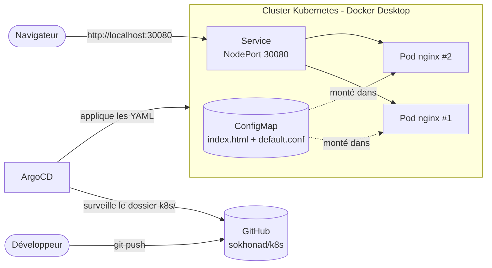
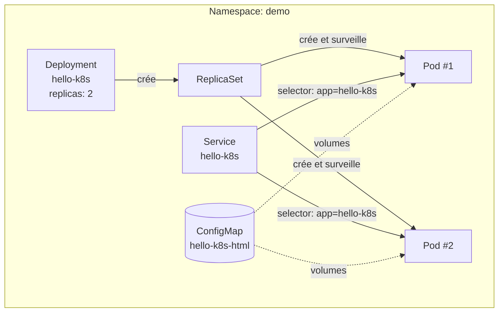
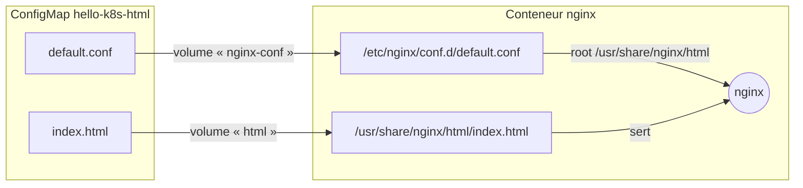
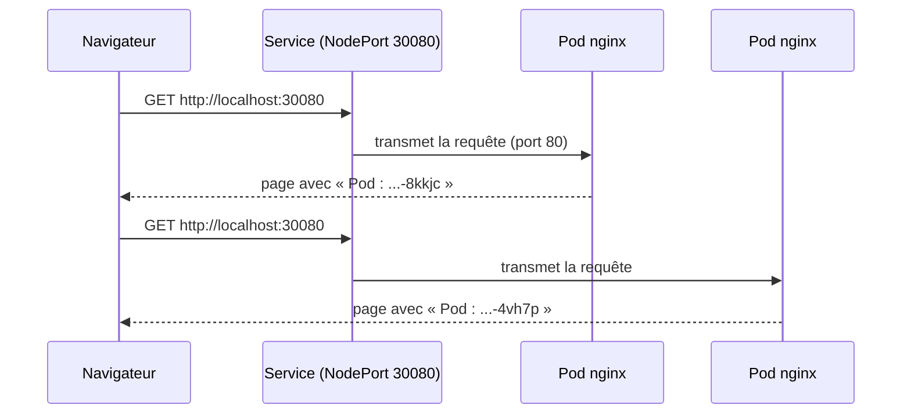
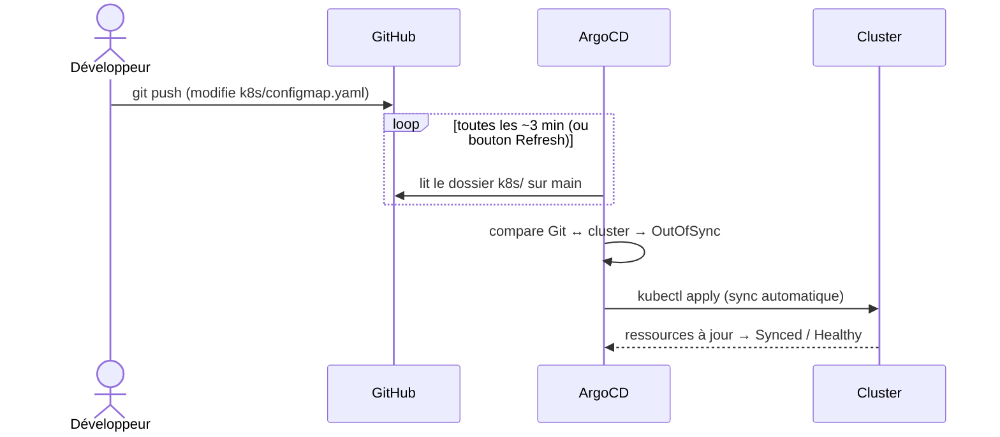
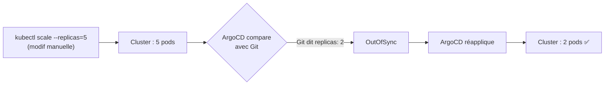

# hello-k8s

Petite application web déployée sur **Kubernetes** et gérée en **GitOps** avec **ArgoCD**.

Un serveur **nginx** sert une page HTML qui affiche le **nom** et l'**IP du pod** qui a répondu, ce qui permet de voir la répartition de charge entre les pods.

---

## Sommaire

- [Vue d'ensemble](#vue-densemble)
- [Structure du dépôt](#structure-du-dépôt)
- [Les ressources Kubernetes](#les-ressources-kubernetes)
- [Comment nginx trouve la page](#comment-nginx-trouve-la-page)
- [Parcours d'une requête](#parcours-dune-requête)
- [Le déploiement GitOps avec ArgoCD](#le-déploiement-gitops-avec-argocd)
- [Prérequis](#prérequis)
- [Installation](#installation)
- [Utilisation au quotidien](#utilisation-au-quotidien)
- [Commandes utiles](#commandes-utiles)
- [Dépannage](#dépannage)

---

## Vue d'ensemble



| Élément | Rôle |
|---|---|
| **GitHub** | Source de vérité : ce qui est dans le dépôt, c'est ce qui tourne dans le cluster |
| **ArgoCD** | Compare Git au cluster et applique automatiquement les différences |
| **Cluster** | Kubernetes à un nœud fourni par Docker Desktop (kubeadm) |
| **Service** | Adresse stable et répartition de charge entre les pods |
| **Pods** | 2 copies de nginx qui servent la page |
| **ConfigMap** | Contient la page HTML et la configuration nginx |

---

## Structure du dépôt

```
.
├── README.md
├── argocd/
│   └── application.yaml     # Dit à ArgoCD quoi déployer et où
└── k8s/
    ├── kustomization.yaml   # Liste des fichiers à appliquer
    ├── namespace.yaml       # Espace "demo"
    ├── configmap.yaml       # Page HTML + config nginx
    ├── deployment.yaml      # 2 pods nginx
    └── service.yaml         # Accès sur le port 30080
```

> ArgoCD ne surveille que le dossier `k8s/`. Le fichier `argocd/application.yaml` s'applique une seule fois, à la main.

---

## Les ressources Kubernetes



| Fichier | Ressource | Ce qu'elle fait |
|---|---|---|
| [namespace.yaml](k8s/namespace.yaml) | `Namespace` | Isole l'app dans un espace `demo` |
| [configmap.yaml](k8s/configmap.yaml) | `ConfigMap` | Stocke `index.html` (la page) et `default.conf` (config nginx) |
| [deployment.yaml](k8s/deployment.yaml) | `Deployment` | Lance 2 pods `nginx:1.27-alpine`, avec limites CPU/RAM et sondes de santé |
| [service.yaml](k8s/service.yaml) | `Service` | Expose les pods sur `localhost:30080` et répartit le trafic |
| [kustomization.yaml](k8s/kustomization.yaml) | Kustomize | Regroupe les 4 fichiers pour `kubectl apply -k` |

### Le lien entre les ressources : les labels

Le Deployment et le Service retrouvent les pods grâce au label `app: hello-k8s`.

```yaml
# deployment.yaml : les pods reçoivent le label
template:
  metadata:
    labels:
      app: hello-k8s

# service.yaml : le Service envoie le trafic aux pods qui portent ce label
selector:
  app: hello-k8s
```

### Santé des pods

| Sonde | Fréquence | Si elle échoue |
|---|---|---|
| `readinessProbe` (`GET /`) | toutes les 5 s | Le pod ne reçoit **plus de trafic** |
| `livenessProbe` (`GET /`) | toutes les 10 s | Le conteneur est **redémarré** |

---

## Comment nginx trouve la page

La page n'est **pas** dans l'image Docker : elle vient de la ConfigMap, montée comme un dossier dans le conteneur.



Cette liaison se fait dans [deployment.yaml](k8s/deployment.yaml), en deux étapes :

```yaml
# 1. La ConfigMap devient un volume
volumes:
  - name: html
    configMap:
      name: hello-k8s-html
      items:
        - key: index.html
          path: index.html

# 2. Le volume est monté dans le dossier que lit nginx
volumeMounts:
  - name: html                         # même nom que le volume
    mountPath: /usr/share/nginx/html
```

### Afficher le nom du pod

La config nginx active les **SSI** (Server Side Includes) avec `ssi on;`. nginx remplace alors ces balises au moment de servir la page :

```html
<!--# echo var="hostname" -->     → nom du pod (ex : hello-k8s-66d5fc4945-8kkjc)
<!--# echo var="server_addr" -->  → IP du pod (ex : 10.1.0.8)
```

Dans Kubernetes, le *hostname* d'un conteneur est le nom de son pod.

---

## Parcours d'une requête



> Un navigateur garde souvent sa connexion ouverte et retombe sur le même pod. Pour voir l'alternance, utilise une fenêtre privée ou `curl` (voir [Commandes utiles](#commandes-utiles)).

---

## Le déploiement GitOps avec ArgoCD

### Le principe

Personne ne lance `kubectl apply` à la main : **on modifie Git, et ArgoCD met le cluster à jour**.



### Configuration de l'application ArgoCD

[argocd/application.yaml](argocd/application.yaml) :

| Champ | Valeur | Signification |
|---|---|---|
| `repoURL` | `https://github.com/sokhonad/k8s.git` | Dépôt à surveiller |
| `targetRevision` | `main` | Branche suivie |
| `path` | `k8s` | Dossier contenant les YAML |
| `destination.namespace` | `demo` | Namespace cible |
| `automated` | activé | Chaque push est déployé automatiquement |
| `selfHeal: true` | activé | Annule les modifications faites à la main dans le cluster |
| `prune: true` | activé | Supprime du cluster ce qui a été supprimé de Git |
| `CreateNamespace=true` | activé | Crée le namespace s'il n'existe pas |

### Auto-réparation (selfHeal)



> Conséquence : pour changer quoi que ce soit (nombre de pods, page, image…), il faut **passer par Git**.

---

## Prérequis

- **Windows** avec la *Plateforme d'ordinateur virtuel* et *WSL* activées (PowerShell en administrateur, puis redémarrage) :
  ```powershell
  Enable-WindowsOptionalFeature -Online -FeatureName VirtualMachinePlatform -All -NoRestart
  Enable-WindowsOptionalFeature -Online -FeatureName Microsoft-Windows-Subsystem-Linux -All -NoRestart
  ```
- **Docker Desktop** avec Kubernetes activé : Settings → Kubernetes → *Enable Kubernetes* → méthode **Kubeadm**
- **kubectl** (fourni avec Docker Desktop)
- **git**

---

## Installation

### 1. Sélectionner le cluster

```powershell
kubectl config use-context docker-desktop
kubectl get nodes        # le nœud doit être "Ready"
```

### 2. Installer ArgoCD

```powershell
kubectl create namespace argocd
kubectl apply -n argocd --server-side -f https://raw.githubusercontent.com/argoproj/argo-cd/stable/manifests/install.yaml
kubectl -n argocd get pods -w     # attendre que tout soit Running, puis Ctrl+C
```

### 3. Ouvrir l'interface ArgoCD

```powershell
# Mot de passe de l'utilisateur "admin"
$p = kubectl -n argocd get secret argocd-initial-admin-secret -o jsonpath="{.data.password}"
[Text.Encoding]::UTF8.GetString([Convert]::FromBase64String($p))

# Accès à l'interface (laisser la fenêtre ouverte)
kubectl -n argocd port-forward svc/argocd-server 8080:443
```

Ouvrir **https://localhost:8080** (accepter l'avertissement de certificat) et se connecter en `admin`.

### 4. Déclarer l'application

```powershell
kubectl apply -f argocd/application.yaml
```

L'application **hello-k8s** apparaît dans ArgoCD et passe à **Synced / Healthy**.

### 5. Tester

Ouvrir **http://localhost:30080**.

> **Sans ArgoCD**, on peut aussi déployer directement : `kubectl apply -k k8s`

---

## Utilisation au quotidien

### Modifier l'application

```powershell
# 1. Modifier un fichier dans k8s/ (ex : le titre dans configmap.yaml)
# 2. Pousser
git commit -am "Nouveau titre"
git push
# 3. Dans ArgoCD : bouton Refresh (sinon détection en ~3 min)
```

> Quand seule la ConfigMap change, nginx peut mettre jusqu'à une minute à voir la nouvelle page. Pour l'afficher tout de suite : **Restart** sur le Deployment dans ArgoCD, ou
> `kubectl -n demo rollout restart deployment/hello-k8s`

### Changer le nombre de pods

Modifier `replicas` dans [deployment.yaml](k8s/deployment.yaml), puis `git commit` et `git push`.

---

## Commandes utiles

```powershell
# État de l'application
kubectl -n demo get pods,svc -o wide
kubectl -n argocd get applications

# Voir quel pod répond (6 requêtes)
1..6 | % { (curl.exe -s http://localhost:30080) -match "Pod : <strong>(.*?)</strong>" | Out-Null; $Matches[1] }

# Logs nginx
kubectl -n demo logs deploy/hello-k8s

# Regarder les fichiers montés dans un pod
kubectl -n demo exec deploy/hello-k8s -- cat /usr/share/nginx/html/index.html
kubectl -n demo exec deploy/hello-k8s -- cat /etc/nginx/conf.d/default.conf

# Tester l'auto-réparation : supprimer un pod, Kubernetes en recrée un
kubectl -n demo delete pod <nom-du-pod>
kubectl -n demo get pods

# Tout supprimer
kubectl -n argocd delete application hello-k8s   # avec ArgoCD
kubectl delete -k k8s                            # sans ArgoCD
```

---

## Dépannage

| Symptôme | Cause | Solution |
|---|---|---|
| Docker : *Virtual Machine Platform not enabled* | Composant Windows manquant | Voir [Prérequis](#prérequis), puis redémarrer |
| `current-context is not set` | Kubernetes non activé dans Docker Desktop | Settings → Kubernetes → Enable |
| `localhost:30080` refuse la connexion juste après le déploiement | Le port NodePort n'est pas encore ouvert | Attendre quelques secondes |
| `argocd-initial-admin-secret not found` | ArgoCD n'a pas fini de démarrer | Attendre que `argocd-server` soit `Running` |
| `argocd-dex-server` en `Error` : *server.secretkey is missing* | Dex a démarré avant le serveur | Il redémarre seul ; non bloquant pour la connexion `admin` |
| ArgoCD : *authentication required: Repository not found* | Dépôt GitHub privé | Rendre le dépôt public, ou l'ajouter avec un token dans Settings → Repositories |
| Ancienne page affichée après un push | nginx n'a pas encore relu la ConfigMap | Restart du Deployment |
| Le nombre de pods revient tout seul à 2 | `selfHeal` d'ArgoCD | Normal : modifier `replicas` dans Git |
