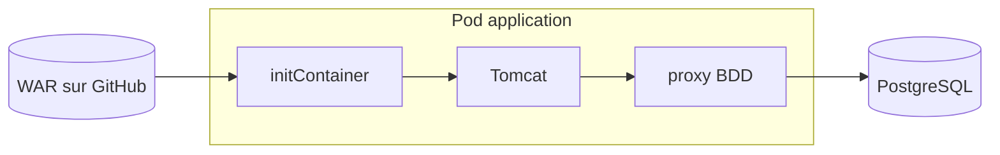

# Exercice 10 : Déployer une application Java (WAR)

**Durée :** 2 h · **Niveau :** avancé

## Objectif

Déployer une vraie application Java avec sa base de données, **sans modifier ni recompiler** le fichier WAR fourni.

## Contexte

Le fichier [MyWebAppv1.war](../MyWebAppv1.war) est une application d'inscription d'utilisateurs. Vous ne disposez **que du WAR**, pas du code source. Votre première mission est d'enquêter.



## Travail demandé

### Partie A : enquêter sur le WAR

Un WAR est une archive ZIP. Ouvrez-la sans l'exécuter, puis répondez :

1. Quelle **version de Java** a servi à le compiler ? *(Indice : `MANIFEST.MF`, ou l'octet de version des `.class`.)*
2. Utilise-t-il `javax.servlet` ou `jakarta.servlet` ? Quelle **version de Tomcat** faut-il donc ?
3. Quelle **base de données** utilise-t-il ? Avec quels identifiants ?
4. À quelle **adresse** se connecte-t-il à la base ?
5. Quelle est la **version** du `web.xml` ? Quelle conséquence a-t-elle sur les annotations `@WebServlet` ?
6. Quelle **table** et quelles **colonnes** l'application attend-elle ?
7. Repérez au moins **un problème de sécurité**.

### Partie B : la base de données

Dans un dossier `apps/mywebapp/`, créez :

8. Un **Namespace** `mywebapp`.
9. Un **Secret** `postgres` avec les identifiants trouvés en partie A.
10. Une **ConfigMap** contenant le script SQL de création de la table.
11. Un **PersistentVolumeClaim** de 1 Gi pour les données.
12. Un **Deployment** `postgres:16-alpine` qui utilise le Secret, exécute le script au premier démarrage et stocke ses données sur le PVC.
13. Un **Service** `postgres` (ClusterIP, port 5432).

### Partie C : l'application

14. Un **Deployment** `mywebapp` avec :
    - un **initContainer** qui télécharge le WAR, le décompresse comme application `ROOT` et applique les corrections nécessaires ;
    - un conteneur **Tomcat** de la bonne version ;
    - un conteneur **sidecar** qui rend la base accessible à l'adresse attendue par le WAR.
15. Un **Service** NodePort sur le port **30081**.
16. Un `kustomization.yaml`, et une **Application ArgoCD** `mywebapp`.

### Partie D : tester

17. Inscrivez un utilisateur depuis http://localhost:30081.
18. Vérifiez qu'il apparaît dans la liste **et** dans la base.
19. Supprimez le pod PostgreSQL. L'utilisateur est-il toujours là après le redémarrage ?

## Critères de réussite

- [ ] Les 7 questions de la partie A ont une réponse justifiée
- [ ] Le pod de l'application est `2/2 Running`
- [ ] L'inscription redirige vers la page de succès
- [ ] La liste des utilisateurs s'affiche
- [ ] Les données survivent à la suppression du pod PostgreSQL
- [ ] L'application est **Synced / Healthy** dans ArgoCD

## Indices

<details>
<summary>Lister le contenu du WAR</summary>

```bash
unzip -l MyWebAppv1.war
unzip -p MyWebAppv1.war WEB-INF/web.xml
unzip -p MyWebAppv1.war META-INF/MANIFEST.MF
```

Version de bytecode : les octets 7 et 8 d'un `.class` valent `0 52` pour Java 8, `0 55` pour Java 11, `0 61` pour Java 17.
</details>

<details>
<summary>Les servlets répondent 404</summary>

Avec un `web.xml` en version 2.3 ou 2.4, Tomcat considère que **toute** la configuration est dans le fichier et ignore les annotations. Fournissez un `web.xml` en version 3.0 ou plus, avec `metadata-complete="false"`.
</details>

<details>
<summary>Erreur « No suitable driver found »</summary>

`DriverManager` ne voit pas les pilotes JDBC placés dans `WEB-INF/lib`. Déplacez le `.jar` PostgreSQL dans `/usr/local/tomcat/lib`. Monter un seul fichier se fait avec `subPath`.
</details>

<details>
<summary>Le WAR veut se connecter à localhost</summary>

Les conteneurs d'un même pod partagent le même `localhost`. Un sidecar `socat` peut écouter sur le port 5432 et tout renvoyer au Service `postgres` :

```yaml
- name: db-proxy
  image: alpine/socat:1.8.0.3
  args: ["TCP-LISTEN:5432,fork,reuseaddr", "TCP:postgres:5432"]
```
</details>

<details>
<summary>Erreur sur la colonne date_of_birth</summary>

Le servlet envoie la date avec `setString()`. Une colonne de type `DATE` la refuse : utilisez `VARCHAR`.
</details>

<details>
<summary>Exécuter une requête SQL dans le pod</summary>

```powershell
kubectl -n mywebapp exec deploy/postgres -- psql -U userdb -d mywebapp -c "select * from users;"
```
</details>

## Pour aller plus loin

- Le WAR redirige vers `error.jsp` en cas d'erreur. Cette page existe-t-elle ? Provoquez une erreur pour le vérifier.
- Pourquoi la stratégie `Recreate` est-elle préférable à `RollingUpdate` pour PostgreSQL ?
